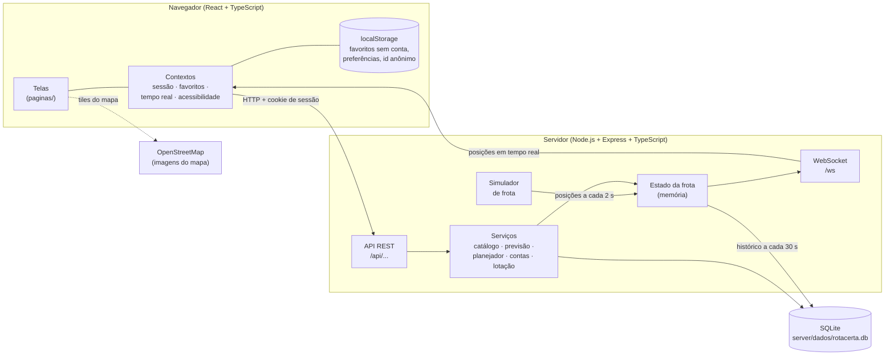
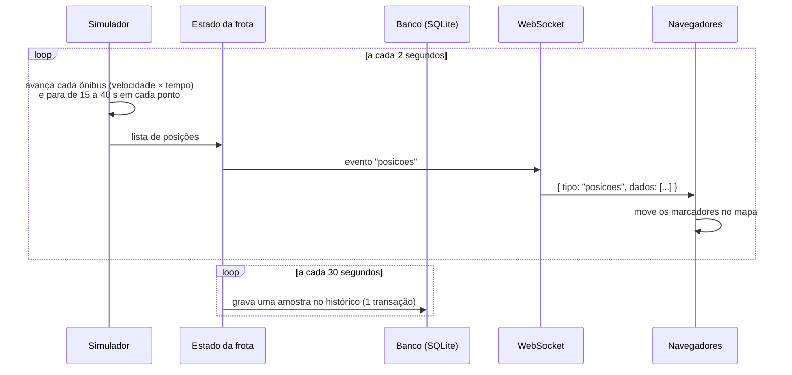
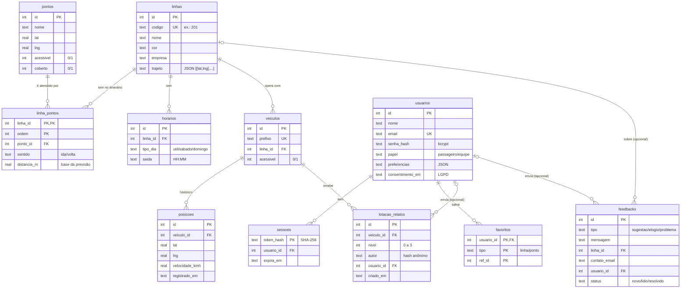

# Arquitetura do RotaCerta

Este documento descreve **como o sistema é organizado**: as partes, como elas conversam, o modelo do banco e em que arquivo está cada requisito. O **porquê** de cada decisão técnica está no [README](../README.md#por-que-cada-escolha-técnica).

## 1. Visão geral



| Camada | Tecnologia | Papel |
|---|---|---|
| Interface | React 19, TypeScript, React Router, Leaflet | Telas, mapa, acessibilidade |
| Comunicação | HTTP/JSON (REST) + WebSocket | Consultas e ações (REST); posições ao vivo (WebSocket) |
| Servidor | Node.js 22+, Express 5, TypeScript | Regras de negócio, autenticação, simulação |
| Banco | SQLite (`node:sqlite`, embutido no Node) | Linhas, pontos, horários, contas, relatos |
| Mapas | OpenStreetMap | Imagens de fundo do mapa (gratuitas, sem chave) |

Em desenvolvimento (`npm run dev`) há dois processos: o Vite serve o site na porta 5173 e repassa `/api` e `/ws` para a API na 3333. Em produção ou na apresentação (`npm run apresentacao`), a própria API entrega o site compilado (`web/dist`), num processo único na porta 3333.

## 2. O caminho de uma posição de ônibus



A **previsão de chegada** e o **planejador** usam o mesmo estado em memória. Por isso a previsão mostrada no ponto e a espera calculada no planejador sempre batem.

## 3. Modelo de dados



**Decisões de modelagem:**
- **`linha_pontos` resolve a relação N:N** entre linhas e pontos: uma linha passa por vários pontos e um ponto recebe várias linhas. A chave é `(linha_id, ordem)`, e não `(linha_id, ponto_id)`, porque **o mesmo ponto aparece duas vezes** na mesma linha, uma na ida e outra na volta.
- **`distancia_m`** guarda a distância do ponto ao início do trajeto, calculada uma vez na carga. Com ela, a previsão de chegada vira uma subtração.
- **`favoritos.ref_id` não tem chave estrangeira**, porque aponta para `linhas` *ou* para `pontos`, conforme o `tipo`. A validação fica na API (`routes/favoritos.ts`). É uma troca consciente: o SQL não tem FK "polimórfica", e criar duas tabelas de favoritos complicaria as consultas.
- **Integridade:** `CHECK` em todos os campos com valores fechados, como `tipo_dia`, `sentido` e `nivel`, e `ON DELETE CASCADE` onde apagar o "pai" deve apagar os "filhos". Por exemplo, excluir a conta apaga as sessões e os favoritos.
- **Versão do banco:** `PRAGMA user_version`, controlado por `db/migracoes.ts`. Versão atual: **4**.

| Versão | O que mudou |
|---|---|
| 1 | Estrutura base: linhas, pontos, itinerários, veículos, horários, posições |
| 2 | Contas, sessões, favoritos; conta de demonstração |
| 3 | Remoção da tabela de avisos (RF05 retirado do escopo) |
| 4 | Papéis de usuário, lotação colaborativa, feedback; conta da equipe |

## 4. Onde está cada requisito

| Req. | Funcionalidade | Back-end | Front-end |
|---|---|---|---|
| RF01 | Mapa em tempo real | `realtime/simulador.ts`, `realtime/estado.ts`, `realtime/ws.ts` | `paginas/PaginaMapa.tsx`, `componentes/MapaFrota.tsx`, `contexto/TempoReal.tsx` |
| RF02 | Previsão de chegada | `services/previsao.ts`, `routes/pontos.ts` | `paginas/PaginaPonto.tsx` |
| RF03 | Linhas e horários | `services/catalogo.ts`, `routes/linhas.ts` | `paginas/PaginaLinhas.tsx`, `paginas/PaginaLinha.tsx` |
| RF04 | Planejador de trajetos | `services/planejador.ts`, `routes/planejar.ts` | `paginas/PaginaPlanejar.tsx`, `componentes/MapaPlano.tsx` |
| ~~RF05~~ | ~~Notificações~~ | retirado do escopo pelo grupo | — |
| RF06 | Favoritos | `routes/favoritos.ts` | `contexto/Favoritos.tsx`, `paginas/PaginaFavoritos.tsx`, `componentes/BotaoFavorito.tsx` |
| RF07 | Acessibilidade | campos `acessivel` em `pontos` e `veiculos`; modo acessível do planejador | `contexto/Acessibilidade.tsx`, `componentes/BarraAcessibilidade.tsx`, `estilos.css` |
| RF08 | Cadastro e login | `services/auth.ts`, `routes/auth.ts` | `contexto/Sessao.tsx`, `paginas/PaginaEntrar.tsx`, `paginas/PaginaConta.tsx` |
| RF09 | Lotação colaborativa | `services/lotacao.ts`, `routes/lotacao.ts` | `componentes/Lotacao.tsx` |
| RF10 | Canal de feedback | `routes/feedback.ts` | `paginas/PaginaFeedback.tsx`, `paginas/PaginaEquipe.tsx` |
| RF11 | Impressão de horários | `routes/linhas.ts` (horários) | `paginas/PaginaImprimir.tsx` + `@media print` em `estilos.css` |

## 5. Disciplinas do semestre no código

A seção 3 da documentação lista as disciplinas aplicadas. Onde cada uma aparece:

| Disciplina | Onde aparece |
|---|---|
| **Programação** | Simulador de frota, cálculo de previsão (`previsao.ts`), lógica de lotação (`lotacao.ts`), toda a interface em React |
| **Banco de Dados** | Modelo relacional acima; `schema.sql`; migrações versionadas; transações na carga e no histórico; índices nas consultas frequentes; `CHECK` e `ON DELETE CASCADE` |
| **Estrutura de Dados** | **Grafo** da rede e **algoritmo de Dijkstra** com **heap binário** (`planejador.ts`); **busca binária** para posicionar o ônibus no trajeto (`geo.ts`); **mapas (hash)** para o estado da frota e o catálogo em memória |
| **Engenharia de Software** | Requisitos RF01–RF11 rastreados até o código (seção 4); 26 testes automatizados (unitários e de integração); versionamento com Git e Conventional Commits; registro de decisões no README |
| **IHC** | Personas guiando decisões (Helena: fonte grande, alto contraste, modo acessível; Marcos: horário de relógio na previsão); WCAG 2.1 AA verificada com axe-core; layout responsivo; navegação por teclado |
| **Redes de Computadores** | WebSocket (conexão persistente, *push* do servidor) × HTTP (requisição e resposta); reconexão com *exponential backoff*; cookies `httpOnly`/`SameSite`; proxy reverso do Vite; mesma origem (sem CORS); acesso pela rede local (LAN) para testar no celular |

## 6. Testes

```bash
npm test
```

Esse comando roda os 26 testes do back-end com o Vitest, num **banco em memória** que é criado a cada execução e não toca no `rotacerta.db`.

| Arquivo | O que testa |
|---|---|
| `services/previsao.test.ts` | Distância de Haversine; interpolação no trajeto; "dar a volta" no circuito; tempo de paradas; velocidade operacional; previsões separadas por sentido |
| `services/planejador.test.ts` | Viagem direta; baldeação respeitando a margem de tempo; caminhada até ponto próximo; modo acessível; rede sem ônibus |
| `api.test.ts` | Integração via HTTP: conta demo; cadastro, sessão e logout; validações; mensagem de erro uniforme e bloqueio após 5 tentativas; exclusão de conta (LGPD); favoritos e importação; lotação (validade, uma voz por pessoa, peso por idade); feedback (validação, *honeypot*, permissão da equipe) |

Além dos testes automáticos, foram feitos **testes de ponta a ponta no navegador** em cada etapa e uma **auditoria de acessibilidade com o axe-core** em todas as telas, que terminou com zero violações (ver README).

## 7. Limitações conhecidas

- **Dados simulados:** as linhas, os trajetos (em linha reta entre os pontos) e as posições são de demonstração. Para usar dados reais, basta um novo `ProvedorPosicoes` (`realtime/tipos.ts`) e uma carga de dados oficiais no lugar de `dados-sorocaba.ts`.
- **Feriados** contam como dia útil na escolha da tabela de horários.
- **O planejador parte de pontos de parada**, e não de endereços: buscar por endereço exigiria um serviço de geocodificação.
- **As contas ficam no computador onde foram criadas**, porque o banco é local. As duas contas de demonstração existem em todos.
- **O mapa de fundo precisa de internet**, porque as imagens vêm do OpenStreetMap. Sem internet, o resto funciona, mas o fundo do mapa fica cinza.
- **Limite de tentativas em memória:** reiniciar o servidor zera as contagens de login, feedback e lotação.
